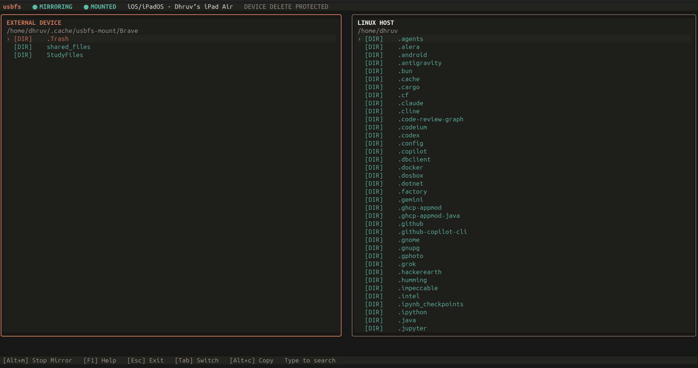

# usbfs

`usbfs` is a dual-pane terminal file manager for copying files between a Linux computer and a USB-connected Android phone, iPhone, or iPad. The external device is on the left and the Linux host is on the right. Browse and filter either pane, open files in Linux desktop applications, and copy files and folders with the keyboard or mouse.

[Install](#install) · [Connect a device](#connect-a-device) · [Controls](#controls) · [Copy and manage files](#copy-and-manage-files) · [Screen mirroring](#screen-mirroring) · [Safe exit](#safe-exit) · [Troubleshooting](#troubleshooting) · [Development](#development)



## Install

### Quick install on Ubuntu 24.04

Run this command as your regular user. It requires `curl` (`sudo apt install curl` if needed). The installer downloads the source from GitHub, uses `sudo` for Ubuntu packages, and builds `usbfs` into `~/.local/bin`.

```bash
(installer=$(curl -fsSL https://raw.githubusercontent.com/dhruvkshah75/usbfs/main/install.sh) && bash -c "$installer")
```

The installer installs FUSE tools and both Android and iPhone/iPad drivers. If Go is missing, it installs Ubuntu's `golang-1.25-go` package from Universe. If `apt` cannot find a package, enable Universe with `sudo add-apt-repository universe` and rerun the installer. See the [Ubuntu Go package](https://packages.ubuntu.com/noble-updates/golang-1.25-go).

Launch with `~/.local/bin/usbfs`. To skip package installation, including on other Linux distributions, change the last part of the install command to `bash -c "$installer" -- --skip-system-deps`. To update, rerun the install command. To uninstall, exit `usbfs` normally and remove `~/.local/bin/usbfs`.

### Requirements

- A Linux host with FUSE support and access to `/dev/fuse` and the USB device. The package commands below are for Ubuntu 24.04 LTS. On other Linux distributions, use packages that provide the same commands.
- A USB data cable and an unlocked phone or tablet. A charging-only cable cannot transfer files.
- An interactive terminal. Drag and drop requires terminal mouse reporting and enough room to display both panes. Keyboard copying works in the compact layout.
- Go **1.25.0 or newer** to build from source, as specified in [go.mod](go.mod). Use the [official Go installation instructions](https://go.dev/doc/install) and verify with `go version`. Git is needed to clone the repository. The initial build needs access to Go module downloads unless the dependencies are already cached.

### Install the system tools manually

```bash
sudo apt update
sudo apt install fuse3 xdg-utils
```

Clipboard image saving has an optional dependency. On Ubuntu, install `wl-clipboard` for a Wayland session or `xclip` for an X11 session. Use the desktop clipboard on the machine running `usbfs`.

Install the dependencies for the device types you plan to use. You can install both sets on the same computer.

```bash
# Android
sudo apt install jmtpfs

# iPhone and iPad
sudo apt install ifuse libimobiledevice-utils usbmuxd
```

| Component | Purpose |
| --- | --- |
| `fuse3` | Provides `fusermount3` for verified unmounting. `usbfs` also supports `fusermount`. Install each driver's runtime dependencies through your package manager. |
| `jmtpfs` or `simple-mtpfs` | Makes Android's Media Transfer Protocol (MTP) storage available as a Linux filesystem. `jmtpfs` is the Ubuntu install path above. If both are on `PATH`, `usbfs` chooses `simple-mtpfs`. |
| `ifuse` | Mounts Apple media and app document shares. Use a build that supports `--documents` and `--list-apps` for full share discovery. |
| `libimobiledevice-utils` and `usbmuxd` | Provide `idevice_id` for Apple device discovery, `idevicepair` for pairing diagnostics, and the Linux service that communicates with the Apple device over USB. |
| `xdg-utils` | Provides `xdg-open` for opening a file in the default desktop app. Browsing and copying can work without it. Opening files also requires a suitable installed desktop app and desktop session. |

On Ubuntu, if `apt` cannot locate `jmtpfs`, `ifuse`, or `libimobiledevice-utils`, run `sudo add-apt-repository universe`, then `sudo apt update` and retry. [Ubuntu package index for jmtpfs](https://packages.ubuntu.com/jmtpfs) · [Ubuntu package index for ifuse](https://packages.ubuntu.com/noble/ifuse) · [Ubuntu package index for libimobiledevice-utils](https://packages.ubuntu.com/search?keywords=libimobiledevice-utils&suite=noble)

### Build and launch manually

Skip the clone step if you already have this checkout.

```bash
git clone https://github.com/dhruvkshah75/usbfs.git
cd usbfs
go version
go build -o ./usbfs ./cmd/usbfs
./usbfs
```

Run `usbfs` as your regular Linux user. The Linux pane starts in the directory you launched it from. The app asks you to choose Android or iPhone/iPad, checks the selected platform's tools on `PATH`, and shows an install hint for any required commands it cannot find.

To run it from any folder, install the built binary in your user's bin directory.

```bash
install -Dm755 ./usbfs "$HOME/.local/bin/usbfs"
export PATH="$HOME/.local/bin:$PATH"
usbfs
```

Add the `export PATH=...` line to your shell's startup file if that directory is missing from `PATH` in new terminals. To update a local installation, rebuild from the updated source and rerun the `install` command. To uninstall, exit the app normally, then remove the binary you installed.

## Connect a device

### Android

1. Plug in the phone and unlock it.
2. Open the phone's USB notification. Under **Use USB for**, choose **File transfer / Android Auto** or **File transfer**.
3. In `usbfs`, press `a` to choose Android. When the mount is ready, open the storage listed in the external pane.
4. If Ubuntu Files has already opened the phone, eject the phone's entry from the Files sidebar, leave the cable connected, and press `r` on the `usbfs` waiting screen.

Android exposes storage through MTP, typically shared internal storage and any removable storage the phone exposes. Charging only, photo transfer (PTP), tethering, and MIDI are separate USB modes. The MTP helper stays alive for the duration of the mount, including while you are idle. `usbfs` browses the files Android exposes and copies them when you request a transfer. [Android USB file-transfer guide](https://support.google.com/android/answer/9064445) · [jmtpfs](https://github.com/JasonFerrara/jmtpfs) · [simple-mtpfs](https://github.com/phatina/simple-mtpfs)

### iPhone or iPad

1. Plug in and unlock the device.
2. Tap **Trust** on the device if asked and approve pairing with your passcode if prompted.
3. In `usbfs`, press `i` to choose iPhone/iPad. Open a share in the external pane to browse it or create files there.

| Share | What it contains |
| --- | --- |
| `Goodnotes/` | The shared Documents container for `com.goodnotesapp.x`, when available. It is listed first. |
| `Media/` | The device's media area, which commonly includes `DCIM` when photos are present. |
| Other app folders | Shared Documents containers reported by `ifuse --list-apps`. Folder names come from app display names, with suffixes for naming collisions. Examples such as Brave or Chrome appear only when the device offers those shares. |

`usbfs` shows the USB shares Apple makes available. **On My iPhone/iPad** in the Files app is a separate view and can contain locations from other file providers. An item created inside a share appears in Files when that app exposes the location there. The Goodnotes share is distinct from the notebook library in the Goodnotes app. Use Goodnotes' export or import controls to move notebooks between the library and Files. If one share is unavailable, `usbfs` reports it and keeps the shares that mounted successfully. [ifuse documentation](https://github.com/libimobiledevice/ifuse/blob/master/docs/ifuse.1) · [Apple's file provider documentation](https://developer.apple.com/documentation/fileprovider) · [Goodnotes import guide](https://support.goodnotes.com/hc/en-us/articles/7353717816463-Import-files-into-Goodnotes)

### Startup and mount locations

Choose the platform first. `usbfs` then detects and mounts the first device returned by that platform's utility. For predictable selection, connect one device of the chosen platform. The waiting screen normally checks again every two seconds. An Android connection conflict or failed MTP session pauses polling until you press `r`. Press `b` on the waiting screen to return to device selection when no mount is active.

The external pane displays a **local Linux mount path**. The phone's files are accessed through that path over USB.

| Path | Purpose |
| --- | --- |
| `~/.cache/usbfs-mount` | Android mounts directly here. For iPhone/iPad, this directory holds a separate FUSE mount for each Apple share. |
| `~/.cache/usbfs-mount.lock` | Prevents two `usbfs` instances under the same home directory from competing for the mount. The lock is held for the session. The file can remain after the app exits. |

Keep the mount directory reserved for `usbfs`. It is used as a filesystem mount point. Each Apple share needs an empty, user-owned local mount directory without write access for other users. Stale, recognized `usbfs` mounts are checked and cleaned up before a new mount attempt.

## Controls

| Action | Control |
| --- | --- |
| Choose platform at startup | `a` Android, `i` iPhone/iPad |
| Retry detection or return to device selection while unmounted | `r` retry, `b` device selection |
| Switch pane | `Tab`, or click in a pane |
| Select a row | `↑`, `↓`, or the mouse wheel. Clicking a file or a Linux host row also selects it. |
| Enter a folder or open a file | `→` or `Enter`. Click a folder in the external device pane to open it. |
| Go up a directory | `←`. The device pane stops at its mount root. |
| Search the focused pane and its subfolders | Start typing. `Backspace` erases one character, and `Esc` or `Ctrl+U` clears the search. |
| Save a clipboard image | `Ctrl+V`, edit the filename, and press `Enter` to save in the focused folder. |
| Show selected item details | `Alt+I`. Scroll with `↑` / `↓` or the mouse wheel, and press `Esc` to close. |
| Copy to the other pane | `Alt+C` or drag a file or folder. Confirm folder copies with `y` or cancel with `n` / `Esc`. |
| Refresh | `Alt+R` refreshes both directory listings and reruns active searches. |
| Create a directory or empty file | `Ctrl+N` directory, `Ctrl+F` empty file. Name it and press `Enter`, or press `Esc` to cancel. |
| Delete a regular Linux file | `Delete`, then `y` to permanently delete or `n` / `Esc` to cancel |
| Open or close the centered Help window | `F1`. `Esc` also closes it. Scroll with `↑` / `↓`, the mouse wheel, `PgUp` / `PgDn`, or `Home` / `End`. |
| Toggle Android screen mirroring | `Alt+m` or click **Mirror Screen / Stop Mirror** in the device header. |
| Exit | `Esc` or `Alt+Q`. During a search, the first `Esc` clears it. If a device is mounted, confirm exit with `y` or cancel with `n` / `Esc`. Plain `q` also works on the setup screen. |

The coral highlight shows the active selection. `[DIR]` marks folders and `[LOCKED]` marks entries the pane cannot open. Typing matches names in the focused pane case-insensitively and ignores whitespace. Current-folder matches appear first, and subfolder matches appear below them as the search finds them, starting with nearby folders. Each pane keeps its own query when you switch focus. Changing directories clears that pane's query. If the terminal is narrow, the app stacks the panes or displays just the focused one.

From the iPhone/iPad share picker, searching covers all mounted shares. Nested results show relative paths so identical names can be distinguished. Use the usual controls to open or copy a result. The recursive walk skips symbolic links, reports unreadable locations, and shows up to 1,000 nested matches.

## Copy and manage files

- **Keyboard copy.** Open the destination folder in one pane, switch to the source pane, select a file or folder, and press `Alt+C`.
- **Mouse copy.** Drag a file or folder into the opposite pane. Drop onto a folder row to copy inside it, or drop into blank space to copy into that pane's open folder. The destination highlights during the drag, and the status area reports the target, progress, and success or failure. Use this in either direction.
- **Create items.** Open the folder where you want the new directory or empty file and press `Ctrl+N` or `Ctrl+F`. Enter a single name. For iPhone/iPad, open a mounted share such as Goodnotes or Brave first. Available operations depend on the device and the folder's permissions.
- **Save a clipboard image.** Copy image data in a desktop app or take a screenshot to the clipboard. Open the destination in either pane and press `Ctrl+V`. Keep or edit the proposed filename, then press `Enter` to save or `Esc` to cancel. On iPhone/iPad, open a writable share first. Existing files are protected. The clipboard must offer PNG or JPEG image data up to 32 MiB.
- **Inspect an item.** Press `Alt+I` to see its full name, path, type, size, and last modified time as reported by the filesystem. On iPhone/iPad the dialog also identifies the mounted share. Sizes use the largest applicable decimal unit from B, KB, MB, and GB, rounded down to a whole number. For example, 100 million bytes shows as 100 MB. Folder size totals the regular files inside it, including nested folders. The dialog marks the total as partial if some entries are unreadable or the scan takes too long. The same shortcut works on recursive search results.
- **Open files.** Select a file and press `Enter` or `→` to launch the Linux default app with `xdg-open`. For a device file, the app receives the mounted file path. If you plan to edit the file, first copy it to Linux and edit that copy. File operations in the launched desktop app are governed by that app and the filesystem.
- **Delete on Linux.** Select a regular file in the Linux host pane, press `Delete`, and read the confirmation before pressing `y`. The action is permanent. Folders, including empty ones, symbolic links, and external-device items are protected.

Folder copying previews the destination and file count before starting. It copies regular files and empty folders, skips symbolic links and other special entries, and reports conflicts and failures. Choose a destination where the top-level folder name is free. If a copy fails partway through, items already copied remain in place. Both directions preserve existing items. New-item creation also rejects names that already exist. Rename, move, and external deletion are outside the in-app file operations.

Downloads are written to a temporary file in the destination and published at the final name only after a complete copy. The Linux destination filesystem must support hard links for that final step. An interrupted or unverified upload may leave a new partial file on the device. Check it on the device before retrying, since `usbfs` will reject the occupied name. Large MTP transfers may also need temporary disk space on Linux, depending on the driver. [jmtpfs implementation notes](https://github.com/JasonFerrara/jmtpfs#readme)

## Screen mirroring

On Ubuntu, install `adb` with `sudo apt install adb` and put the latest official
`scrcpy` release on `PATH`. Run `usbfs` from your graphical desktop session.
Optionally install `libnotify-bin` for desktop notifications after a file push.
See the [official scrcpy Linux installation instructions](https://github.com/Genymobile/scrcpy/blob/master/doc/linux.md).

Enable **USB debugging** in Android's **Developer options**, unlock the phone,
and accept the **Allow USB debugging** prompt. Once the phone is mounted in
`usbfs`, press `Alt+m` or click **Mirror Screen**. See [Android's USB debugging instructions](https://developer.android.com/tools/adb#Enabling).

Use the desktop mirror window to control the phone with the mouse and
keyboard. Drag a non-APK file onto the window to push it to
`/sdcard/Download/`. Scrcpy handles these drops directly and can replace a
same-named file. It handles APK drops as installation requests. The physical
screen turns off while the mirror is open, and mounting and file browsing
continue in the TUI. Click **Stop Mirror**, press `Alt+m` again, or close the window
to stop the mirror. [Scrcpy controls and drag-and-drop behavior](https://github.com/Genymobile/scrcpy/blob/master/doc/control.md)

## Safe exit

1. Let the active transfer finish. The exit confirmation blocks unmounting while a copy is in progress.
2. Press `Esc` or `Alt+Q`, then confirm with `y`.
3. Wait for the shell message below before unplugging.

```text
[OK] External device cleanly unmounted. It is now safe to unplug the USB cable.
```

The app unmounts child shares before parents, tries `fusermount3 -u` with `fusermount -u` as fallback, and checks the Linux mount table. It waits for the mount helpers to exit and removes empty Apple share mount directories after verifying the mounts are gone. If a mount remains busy, the app retries with backoff while retaining its session lock. Close files opened from the mount and change out of it in other terminals.

`Ctrl+C`, `SIGINT`, `SIGTERM`, and `SIGHUP` also enter cleanup. An uncatchable termination such as `SIGKILL` or a power loss can interrupt cleanup and leave a stale mount.

## Troubleshooting

### Android USB connection is busy

On GNOME, `usbfs` reuses the matching Android mount when GNOME Files already has it open. The device header shows **MOUNTED (GVfs)**, and GNOME keeps the mount after `usbfs` exits. Press `r` to detect the mount again if storage appears empty. If no matching mount is available, `usbfs` uses its usual MTP driver.

If another MTP client holds the connection, finish its transfers and eject the phone in that client. Leave the phone connected and unlocked, then press `r` in `usbfs`. [libmtp troubleshooting](https://github.com/libmtp/libmtp/issues/231)

If the conflict persists, you can inspect and release the phone from another terminal using `gio`. If the command is missing on Ubuntu, install `libglib2.0-bin`.

```bash
gio mount -l
```

Find the phone's `mtp://…/` URL in the output. Then run `gio mount --unmount '<phone-mtp-url>'`, replacing the placeholder with that exact URL. Press `r` in `usbfs` afterward. [Ubuntu gio manual](https://manpages.ubuntu.com/manpages/noble/man1/gio.1.html)

### Android is detected but storage did not open

Unlock the phone. In its USB notification, switch to **Charging only**, then back to **File transfer / Android Auto**. Release any desktop MTP mount that reappears and press `r`. If the issue persists, try a known data cable connected directly to a different USB port. With other MTP clients closed, `jmtpfs -l` or `simple-mtpfs -l` lists devices detected by the corresponding installed driver.

### iPhone/iPad or a particular share is missing

Unlock the device, accept **Trust** if prompted, and retry. Run these checks from a Linux terminal.

```bash
idevice_id -l
idevicepair validate
ifuse --list-apps
```

`idevice_id -l` should list the device, `idevicepair validate` checks pairing, and `ifuse --list-apps` lists apps that advertise file sharing. If pairing is missing, run `idevicepair pair` while the device is unlocked and respond to the trust prompt. For listing and pairing diagnostics, connect one Apple device at a time. If a specific share is absent while the media mount works, check that the app is installed and exposes its Documents container over USB. If `ifuse` reports that `--list-apps` is unknown, use a package build that supports app discovery.

### Mount or transfer fails

| Symptom | What to check |
| --- | --- |
| Waiting with no device | Cable, port, unlock state, and the selected platform. On Ubuntu, `lsusb` from the `usbutils` package can confirm the USB hardware is visible. |
| Missing command | Install the package shown in the status and press `r`. If a command is installed in a custom location, make sure that location is on `PATH` in the terminal running `usbfs`. |
| FUSE permission denied or operation not permitted | Run from a regular Linux user session with access to `/dev/fuse`. A restricted container, sandbox, or VM without USB passthrough may prevent the mount. Check device permissions and the distro's USB driver rules. |
| An Apple share's mount directory is not empty | After confirming it is unmounted, inspect the corresponding local directory and move any personal files elsewhere. Retry with the empty directory. |
| Item is locked or destination is read-only | Choose a readable file or a folder the device allows you to write to. Try an ordinary shared folder such as Android's Downloads, or a writable Apple app share. |
| Destination already exists | Choose another destination folder or change the source filename before copying. |
| Download cannot publish its final name | Check free space, permissions, and hard-link support on the Linux destination. Retry in a directory on a filesystem with hard-link support. |
| Mouse drag or Alt shortcuts do not register | Use a terminal with mouse reporting, enlarge the window, or use keyboard copying. Check whether your terminal or multiplexer intercepts the Alt shortcuts. |
| Opening a file fails | Check that `xdg-open` is on `PATH` and that your Linux desktop has a default app for the file type. |
| Another `usbfs` session may be running | Exit the existing session normally and let it finish cleanup before restarting. Removing the lock file is unnecessary. |

### Unmount is stuck

Close any file opened from the device and any file-manager view still inside the mount. In other shells, change to a directory outside `~/.cache/usbfs-mount` with `cd ~`. The existing instance will keep retrying. To see the visible `usbfs` FUSE mounts, use `findmnt` from `util-linux`.

```bash
findmnt -rn -t fuse.usbfs,fuse.ifuse,fuse.jmtpfs,fuse.simple-mtpfs -o TARGET,FSTYPE
```

An Apple session can have several child mounts even if the top-level directory is a plain local folder. If a session was forcibly stopped, relaunch `usbfs` and select your platform to let startup cleanup verify and clear the stale mounts before reuse.

## Development

The Go executable wraps existing USB mount utilities. Bubble Tea manages input and asynchronous commands, Bubbles provides the spinner and name input, and Lip Gloss renders the dark terminal theme.

| Directory | Responsibility |
| --- | --- |
| [`cmd/usbfs`](cmd/usbfs) | Executable, signal handling, and final cleanup |
| [`internal/device`](internal/device) | Driver selection, platform detection, Apple share discovery, session lock, and verified mount lifecycle |
| [`internal/fsops`](internal/fsops) | File listing and launch, new-item creation, and non-overwriting transfers |
| [`internal/mirror`](internal/mirror) | Android ADB preflight, scrcpy process lifecycle, and file-push notifications |
| [`internal/tui`](internal/tui) | Panes, filtering, keyboard and mouse input, confirmations, status updates, and Help |

```bash
go test ./...
go vet ./...
go build -o ./usbfs ./cmd/usbfs
# On a supported platform with cgo and a C compiler
go test -race ./...
```

Automated tests use temporary files and simulated mounts to cover driver detection, iOS share cleanup, transfer safety, filtering, mouse routing, and delete confirmation. For a live smoke test, connect a device, download a small disposable file, create a folder in a writable share, upload a uniquely named test file, then exit and verify that `findmnt` shows no mount for the session. Use files you can inspect and remove on the device itself after the test.

See [SPEC.md](SPEC.md) for the design specification.
